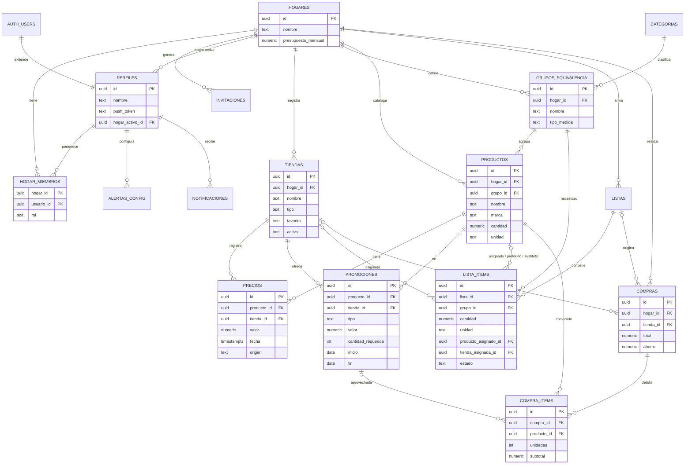

# Backend Schema — MercApp (Supabase / PostgreSQL)

> Versión 2 (2026-10-15) — diseño de la semana 2. Este documento es el **diseño**;
> la creación real se hace en la semana 3 como migraciones de Supabase CLI
> (`supabase migration new <nombre>`), nunca editando el esquema a mano.

La unidad central es el **hogar**: tiendas, catálogo de productos, listas, promociones, precios y compras pertenecen a un hogar. Un usuario puede pertenecer a **varios hogares** y trabaja con uno a la vez (`perfiles.hogar_activo_id`). RLS filtra todo por membresía en `hogar_miembros` mediante la función `es_miembro()`.

## Cambios frente a la versión 1
| # | Cambio | Motivo |
| --- | --- | --- |
| 1 | `productos.hogar_id` + RLS | Catálogo propio por hogar (decisión semana 2); en v1 la tabla tenía RLS sin políticas y nadie podía leerla |
| 2 | Nueva tabla `grupos_equivalencia` con `tipo_medida` | Lista por necesidad genérica, comparación de presentaciones [P12] y sustitución [P11] |
| 3 | `lista_items` apunta a un grupo (necesidad) + resultado del optimizador | Lista por necesidad genérica [P5] |
| 4 | Vistas con `security_invoker = true` | En v1 las vistas se saltaban la RLS y un hogar vería precios de otros |
| 5 | `v_precio_actual` divide también "und" por la cantidad | Decisión semana 2 (huevos x30 → precio por huevo) |
| 6 | `v_historial_resumen`: `anterior` = último precio distinto; agrega `fecha_ultimo_cambio` | Requerido en [P8]; si se registra el mismo precio dos veces la variación no debe quedar en 0 % |
| 7 | `promociones.cantidad_requerida`, `valor` según tipo, checks | "2 unidades por $X" [P7] no se podía guardar con un solo `valor` |
| 8 | Nueva tabla `compra_items` | "Productos más comprados" y "promociones aprovechadas" [P14] |
| 9 | `hogares.presupuesto_mensual` | Presupuesto mensual (decisión semana 2) [P17] |
| 10 | `perfiles.hogar_activo_id` | Varios hogares por usuario |
| 11 | `precios.lectura_ia` y `foto_path` | Medir % de acierto campo por campo; bucket privado (se guarda la ruta, no una URL) |
| 12 | Políticas RLS completas + funciones `crear_hogar`, `generar_invitacion`, `unirse_hogar`, trigger de perfil | En v1 faltaban; sin ellas no se puede crear ni unirse a un hogar |
| 13 | Triggers de consistencia (mismo hogar, unidad compatible con el grupo) | Evitar mezclar datos entre hogares y grupos no comparables |
| 14 | `notificaciones.promocion_id` | La alerta de promo debe abrir la promoción (APP_FLOW §7) |
| 15 | Trigger de alertas sin URL quemada | La URL y la llave se leen de Supabase Vault (se implementa en la semana 7) |

## 0. Diagrama entidad-relación



## 1. Extensiones

```sql
create extension if not exists pg_trgm;   -- búsqueda por similitud de nombre
create extension if not exists pg_net;    -- llamadas HTTP desde triggers (semana 7)
create extension if not exists pg_cron;   -- revisión diaria de promos (semana 7)
```

## 2. Tablas

```sql
create table hogares (
  id uuid primary key default gen_random_uuid(),
  nombre text not null,
  presupuesto_mensual numeric check (presupuesto_mensual > 0),  -- null = sin presupuesto
  creado_en timestamptz not null default now()
);

-- Perfiles (extiende auth.users; se crea por trigger al registrarse)
create table perfiles (
  id uuid primary key references auth.users(id) on delete cascade,
  nombre text not null,
  push_token text,
  hogar_activo_id uuid references hogares(id) on delete set null,
  creado_en timestamptz not null default now()
);

create table hogar_miembros (
  hogar_id uuid not null references hogares(id) on delete cascade,
  usuario_id uuid not null references perfiles(id) on delete cascade,
  rol text not null default 'miembro' check (rol in ('admin','miembro')),
  unido_en timestamptz not null default now(),
  primary key (hogar_id, usuario_id)
);

create table invitaciones (
  codigo text primary key check (codigo ~ '^[A-Z0-9]{6}$'),
  hogar_id uuid not null references hogares(id) on delete cascade,
  creado_por uuid not null references perfiles(id),
  expira_en timestamptz not null default now() + interval '7 days'
);

create table tiendas (
  id uuid primary key default gen_random_uuid(),
  hogar_id uuid not null references hogares(id) on delete cascade,
  nombre text not null,
  tipo text not null default 'otro'
    check (tipo in ('supermercado','tienda_barrio','minimercado','descuento','otro')),
  direccion text,
  lat double precision check (lat between -90 and 90),
  lng double precision check (lng between -180 and 180),
  favorita boolean not null default false,
  activa boolean not null default true,     -- desactivar temporalmente: no entra en comparaciones
  creado_en timestamptz not null default now()
);

-- Lista fija global (semilla), solo lectura para los usuarios
create table categorias (
  id uuid primary key default gen_random_uuid(),
  nombre text not null unique
);

-- Agrupa productos intercambiables: "Arroz blanco", "Leche entera", "Huevos AA"
create table grupos_equivalencia (
  id uuid primary key default gen_random_uuid(),
  hogar_id uuid not null references hogares(id) on delete cascade,
  nombre text not null,
  categoria_id uuid references categorias(id),
  tipo_medida text not null check (tipo_medida in ('peso','volumen','unidad')),
  creado_en timestamptz not null default now(),
  unique (hogar_id, nombre)
);

create table productos (
  id uuid primary key default gen_random_uuid(),
  hogar_id uuid not null references hogares(id) on delete cascade,
  grupo_id uuid not null references grupos_equivalencia(id),
  nombre text not null,
  marca text,
  cantidad numeric not null check (cantidad > 0),   -- p. ej. 500, 1, 30
  unidad text not null check (unidad in ('g','kg','ml','l','und')),
  codigo_barras text,
  creado_en timestamptz not null default now()
);

create table precios (
  id uuid primary key default gen_random_uuid(),
  producto_id uuid not null references productos(id) on delete cascade,
  tienda_id uuid not null references tiendas(id) on delete cascade,
  valor numeric not null check (valor > 0),
  fecha timestamptz not null default now(),      -- en foto: fecha de captura
  origen text not null check (origen in ('manual','foto')),
  foto_path text,                                 -- ruta en el bucket privado 'etiquetas'
  lectura_ia jsonb,     -- lo que devolvió la IA: {nombre, marca, cantidad, unidad, precio, precio_unidad_etiqueta, tienda_detectada}
  confianza_ia jsonb,   -- {nombre: 0.9, precio: 0.95, ...}
  registrado_por uuid not null default auth.uid() references perfiles(id),
  check (origen = 'manual' or foto_path is not null)
  -- nunca se actualiza una fila: cada precio nuevo es un insert (historial completo)
);

-- valor según tipo:
--   descuento_pct -> % de descuento (0-100)
--   precio_fijo   -> precio promocional por unidad
--   n_por_valor   -> precio total por 'cantidad_requerida' unidades ("2 por $X")
--   2x1           -> sin valor (lleva 2, paga 1)
create table promociones (
  id uuid primary key default gen_random_uuid(),
  producto_id uuid not null references productos(id) on delete cascade,
  tienda_id uuid not null references tiendas(id) on delete cascade,
  tipo text not null check (tipo in ('2x1','descuento_pct','precio_fijo','n_por_valor')),
  valor numeric,
  cantidad_requerida integer check (cantidad_requerida >= 2),
  descripcion text,
  inicio date not null,
  fin date not null,
  creado_por uuid not null default auth.uid() references perfiles(id),
  check (fin >= inicio),
  check (
    (tipo = '2x1'           and valor is null and cantidad_requerida is null) or
    (tipo = 'descuento_pct' and valor > 0 and valor < 100 and cantidad_requerida is null) or
    (tipo = 'precio_fijo'   and valor > 0 and cantidad_requerida is null) or
    (tipo = 'n_por_valor'   and valor > 0 and cantidad_requerida is not null)
  )
);

create table listas (
  id uuid primary key default gen_random_uuid(),
  hogar_id uuid not null references hogares(id) on delete cascade,
  nombre text not null default 'Lista de mercado',
  estado text not null default 'activa' check (estado in ('activa','cerrada')),
  estrategia text check (estrategia in ('una_tienda','varias_tiendas')),  -- la que el usuario aplicó
  creada_por uuid not null default auth.uid() references perfiles(id),
  creada_en timestamptz not null default now()
);

-- Cada ítem es una NECESIDAD ("Arroz blanco – 2 kg"). El optimizador llena los campos *_asignado.
create table lista_items (
  id uuid primary key default gen_random_uuid(),
  lista_id uuid not null references listas(id) on delete cascade,
  grupo_id uuid not null references grupos_equivalencia(id),
  cantidad numeric not null default 1 check (cantidad > 0),
  unidad text check (unidad in ('g','kg','ml','l','und')),  -- null = 'cantidad' empaques de la presentación elegida
  producto_preferido_id uuid references productos(id),     -- opcional: el usuario fija marca/presentación
  -- resultado del optimizador
  producto_asignado_id uuid references productos(id),
  tienda_asignada_id uuid references tiendas(id),
  unidades_a_comprar integer check (unidades_a_comprar > 0),
  precio_estimado numeric check (precio_estimado >= 0),
  promocion_id uuid references promociones(id) on delete set null,
  -- seguimiento en la compra (lista compartida)
  estado text not null default 'pendiente'
    check (estado in ('pendiente','comprado','no_disponible','sustituido')),
  sustituto_id uuid references productos(id),
  actualizado_por uuid references perfiles(id) default auth.uid(),
  actualizado_en timestamptz not null default now(),
  check (estado <> 'sustituido' or sustituto_id is not null)
);

create table alertas_config (
  usuario_id uuid not null references perfiles(id) on delete cascade,
  tipo text not null check (tipo in ('precio_minimo','subida_fuerte','bajada','promo_nueva','promo_por_vencer','mas_barato_otra_tienda')),
  activa boolean not null default true,
  umbral_pct numeric default 10 check (umbral_pct > 0),   -- aplica a subida_fuerte y bajada
  primary key (usuario_id, tipo)
);

create table notificaciones (
  id uuid primary key default gen_random_uuid(),
  usuario_id uuid not null references perfiles(id) on delete cascade,
  tipo text not null,
  mensaje text not null,
  producto_id uuid references productos(id) on delete cascade,
  promocion_id uuid references promociones(id) on delete cascade,
  leida boolean not null default false,
  fecha timestamptz not null default now()
);

-- Una fila por tienda cuando se cierra una lista ("Terminar compra")
create table compras (
  id uuid primary key default gen_random_uuid(),
  hogar_id uuid not null references hogares(id) on delete cascade,
  lista_id uuid references listas(id) on delete set null,
  tienda_id uuid references tiendas(id) on delete set null,
  total numeric not null check (total >= 0),
  ahorro numeric not null default 0,   -- vs. la tienda de referencia (PRD §6, D-1)
  registrada_por uuid not null default auth.uid() references perfiles(id),
  fecha timestamptz not null default now()
);

create table compra_items (
  id uuid primary key default gen_random_uuid(),
  compra_id uuid not null references compras(id) on delete cascade,
  producto_id uuid not null references productos(id),
  unidades integer not null check (unidades > 0),
  precio_unitario numeric not null check (precio_unitario > 0),  -- precio normal del empaque
  subtotal numeric not null check (subtotal >= 0),               -- ya con la promo aplicada
  promocion_id uuid references promociones(id) on delete set null
);
```

## 3. Funciones de apoyo y triggers de consistencia

```sql
-- ¿El usuario actual es miembro de este hogar? (security definer evita recursión de RLS)
create or replace function es_miembro(p_hogar uuid) returns boolean
language sql stable security definer set search_path = public as $$
  select exists (select 1 from hogar_miembros
                 where hogar_id = p_hogar and usuario_id = auth.uid());
$$;

create or replace function es_admin(p_hogar uuid) returns boolean
language sql stable security definer set search_path = public as $$
  select exists (select 1 from hogar_miembros
                 where hogar_id = p_hogar and usuario_id = auth.uid() and rol = 'admin');
$$;

-- Crea el perfil cuando alguien se registra en Auth
create or replace function fn_nuevo_usuario() returns trigger
language plpgsql security definer set search_path = public as $$
begin
  insert into perfiles (id, nombre)
  values (new.id, coalesce(new.raw_user_meta_data->>'nombre', split_part(new.email, '@', 1)));
  return new;
end;
$$;

create trigger trg_nuevo_usuario
after insert on auth.users
for each row execute function fn_nuevo_usuario();

-- Crear hogar: inserta el hogar, agrega al creador como admin y lo deja como hogar activo
create or replace function crear_hogar(p_nombre text) returns uuid
language plpgsql security definer set search_path = public as $$
declare v_id uuid;
begin
  if auth.uid() is null then raise exception 'no autenticado'; end if;
  insert into hogares (nombre) values (p_nombre) returning id into v_id;
  insert into hogar_miembros (hogar_id, usuario_id, rol) values (v_id, auth.uid(), 'admin');
  update perfiles set hogar_activo_id = v_id where id = auth.uid();
  return v_id;
end;
$$;

-- Generar código de invitación de 6 caracteres (solo miembros del hogar)
create or replace function generar_invitacion(p_hogar uuid) returns text
language plpgsql security definer set search_path = public as $$
declare v_codigo text;
begin
  if not es_miembro(p_hogar) then raise exception 'no eres miembro de este hogar'; end if;
  loop
    v_codigo := upper(substr(replace(gen_random_uuid()::text, '-', ''), 1, 6));  -- 6 caracteres 0-9/A-F
    exit when not exists (select 1 from invitaciones where codigo = v_codigo);
  end loop;
  insert into invitaciones (codigo, hogar_id, creado_por) values (v_codigo, p_hogar, auth.uid());
  return v_codigo;
end;
$$;

-- Unirse con un código (el invitado aún no es miembro, por eso security definer)
create or replace function unirse_hogar(p_codigo text) returns uuid
language plpgsql security definer set search_path = public as $$
declare v_hogar uuid;
begin
  if auth.uid() is null then raise exception 'no autenticado'; end if;
  select hogar_id into v_hogar from invitaciones
   where codigo = upper(p_codigo) and expira_en > now();
  if v_hogar is null then raise exception 'código inválido o vencido'; end if;
  insert into hogar_miembros (hogar_id, usuario_id) values (v_hogar, auth.uid())
  on conflict do nothing;
  update perfiles set hogar_activo_id = v_hogar where id = auth.uid();
  return v_hogar;
end;
$$;

-- El producto debe usar una unidad compatible con su grupo y ser del mismo hogar
create or replace function fn_validar_producto() returns trigger
language plpgsql as $$
declare v_tipo text; v_hogar uuid;
begin
  select tipo_medida, hogar_id into v_tipo, v_hogar from grupos_equivalencia where id = new.grupo_id;
  if v_hogar <> new.hogar_id then raise exception 'el grupo pertenece a otro hogar'; end if;
  if (v_tipo = 'peso'    and new.unidad not in ('g','kg'))
  or (v_tipo = 'volumen' and new.unidad not in ('ml','l'))
  or (v_tipo = 'unidad'  and new.unidad <> 'und') then
    raise exception 'unidad % no corresponde a un grupo de tipo %', new.unidad, v_tipo;
  end if;
  return new;
end;
$$;

create trigger trg_validar_producto
before insert or update on productos
for each row execute function fn_validar_producto();

-- Precios y promociones: el producto y la tienda deben ser del mismo hogar
create or replace function fn_validar_mismo_hogar() returns trigger
language plpgsql as $$
begin
  if (select hogar_id from productos where id = new.producto_id)
     <> (select hogar_id from tiendas where id = new.tienda_id) then
    raise exception 'producto y tienda pertenecen a hogares distintos';
  end if;
  return new;
end;
$$;

create trigger trg_precios_mismo_hogar before insert or update on precios
for each row execute function fn_validar_mismo_hogar();
create trigger trg_promos_mismo_hogar before insert or update on promociones
for each row execute function fn_validar_mismo_hogar();

-- lista_items: marca de última edición para Realtime (last-write-wins)
create or replace function fn_tocar_lista_item() returns trigger
language plpgsql as $$
begin
  new.actualizado_en := now();
  new.actualizado_por := coalesce(auth.uid(), new.actualizado_por);
  return new;
end;
$$;

create trigger trg_tocar_lista_item before update on lista_items
for each row execute function fn_tocar_lista_item();
```

## 4. Vistas (cálculo, no almacenamiento)

Todas con `security_invoker = true` para que respeten la RLS de quien consulta.

```sql
-- Último precio por producto y tienda, con precio normalizado:
--   g/kg -> por kg · ml/l -> por litro · und -> por unidad (valor / cantidad)
create view v_precio_actual with (security_invoker = true) as
select distinct on (p.producto_id, p.tienda_id)
  p.producto_id, p.tienda_id, pr.hogar_id, pr.grupo_id,
  p.valor, p.fecha, p.origen,
  pr.cantidad, pr.unidad,
  case pr.unidad when 'g' then 'kg' when 'kg' then 'kg'
                 when 'ml' then 'l' when 'l' then 'l' else 'und' end as unidad_base,
  round(p.valor / (pr.cantidad * case pr.unidad when 'g' then 0.001 when 'ml' then 0.001 else 1 end), 2)
    as precio_unidad_base
from precios p
join productos pr on pr.id = p.producto_id
order by p.producto_id, p.tienda_id, p.fecha desc;

-- Historial resumido por producto y tienda
--   anterior            = último precio DISTINTO al actual (registrar el mismo precio otra vez no lo cambia)
--   fecha_ultimo_cambio = fecha en que empezó a regir el precio actual
--   variacion_pct       = actual vs. anterior
create view v_historial_resumen with (security_invoker = true) as
with ordenados as (
  select producto_id, tienda_id, valor, fecha,
         lag(valor) over (partition by producto_id, tienda_id order by fecha) as valor_previo,
         first_value(valor) over (partition by producto_id, tienda_id order by fecha desc) as valor_actual
  from precios
),
resumen as (
  select
    producto_id, tienda_id,
    max(valor_actual) as actual,
    (array_agg(valor order by fecha desc) filter (where valor <> valor_actual))[1] as anterior,
    min(valor) as minimo,
    max(valor) as maximo,
    round(avg(valor), 2) as promedio,
    max(fecha) as ultima_fecha,
    max(fecha) filter (where valor_previo is not null and valor <> valor_previo) as fecha_ultimo_cambio
  from ordenados
  group by producto_id, tienda_id
)
select *,
  round((actual - anterior) / nullif(anterior, 0) * 100, 1) as variacion_pct
from resumen;

-- Promociones vigentes hoy
create view v_promociones_vigentes with (security_invoker = true) as
select * from promociones
where current_date between inicio and fin;

-- Estadísticas mensuales por hogar (gasto, ahorro, # compras, presupuesto)
create view v_estadisticas_mes with (security_invoker = true) as
select
  c.hogar_id,
  date_trunc('month', c.fecha) as mes,
  sum(c.total) as gasto_total,
  sum(c.ahorro) as ahorro_total,
  count(*) as num_compras,
  h.presupuesto_mensual
from compras c
join hogares h on h.id = c.hogar_id
group by c.hogar_id, date_trunc('month', c.fecha), h.presupuesto_mensual;
```

Las vistas de "productos más comprados", "tiendas más usadas", "productos que más subieron" y "promociones aprovechadas" se definen en la semana en que se construya Estadísticas (todas salen de `compra_items`, `compras` y `v_historial_resumen`).

## 5. Row Level Security

```sql
alter table hogares             enable row level security;
alter table perfiles            enable row level security;
alter table hogar_miembros      enable row level security;
alter table invitaciones        enable row level security;
alter table tiendas             enable row level security;
alter table categorias          enable row level security;
alter table grupos_equivalencia enable row level security;
alter table productos           enable row level security;
alter table precios             enable row level security;
alter table promociones         enable row level security;
alter table listas              enable row level security;
alter table lista_items         enable row level security;
alter table alertas_config      enable row level security;
alter table notificaciones      enable row level security;
alter table compras             enable row level security;
alter table compra_items        enable row level security;

-- Hogares: se crean con crear_hogar(); los miembros ven, el admin edita/borra
create policy hogares_select on hogares for select using (es_miembro(id));
create policy hogares_update on hogares for update using (es_admin(id)) with check (es_admin(id));
create policy hogares_delete on hogares for delete using (es_admin(id));

-- Perfiles: ves el tuyo y el de quienes comparten hogar contigo; solo editas el tuyo
create policy perfiles_select on perfiles for select using (
  id = auth.uid() or exists (
    select 1 from hogar_miembros m where m.usuario_id = perfiles.id and es_miembro(m.hogar_id)));
create policy perfiles_update on perfiles for update
  using (id = auth.uid())
  with check (id = auth.uid() and (hogar_activo_id is null or es_miembro(hogar_activo_id)));

-- Miembros: se insertan solo vía crear_hogar()/unirse_hogar(); puedes salirte o el admin te saca
create policy miembros_select on hogar_miembros for select using (es_miembro(hogar_id));
create policy miembros_delete on hogar_miembros for delete
  using (usuario_id = auth.uid() or es_admin(hogar_id));

-- Invitaciones: se crean con generar_invitacion(); los miembros las ven y borran
create policy invitaciones_select on invitaciones for select using (es_miembro(hogar_id));
create policy invitaciones_delete on invitaciones for delete using (es_miembro(hogar_id));

-- Categorías: lectura para cualquier usuario autenticado (la semilla la carga la migración)
create policy categorias_select on categorias for select to authenticated using (true);

-- Tablas con hogar_id directo: los miembros hacen todo
create policy tiendas_all on tiendas for all
  using (es_miembro(hogar_id)) with check (es_miembro(hogar_id));
create policy grupos_all on grupos_equivalencia for all
  using (es_miembro(hogar_id)) with check (es_miembro(hogar_id));
create policy productos_all on productos for all
  using (es_miembro(hogar_id)) with check (es_miembro(hogar_id));
create policy listas_all on listas for all
  using (es_miembro(hogar_id)) with check (es_miembro(hogar_id));
create policy compras_all on compras for all
  using (es_miembro(hogar_id)) with check (es_miembro(hogar_id));

-- Precios: historial inmutable -> solo leer e insertar (y borrar un registro equivocado)
create policy precios_select on precios for select
  using (es_miembro((select hogar_id from tiendas t where t.id = tienda_id)));
create policy precios_insert on precios for insert
  with check (es_miembro((select hogar_id from tiendas t where t.id = tienda_id))
              and registrado_por = auth.uid());
create policy precios_delete on precios for delete
  using (es_miembro((select hogar_id from tiendas t where t.id = tienda_id)));

-- Promociones: por el hogar de la tienda
create policy promociones_all on promociones for all
  using (es_miembro((select hogar_id from tiendas t where t.id = tienda_id)))
  with check (es_miembro((select hogar_id from tiendas t where t.id = tienda_id)));

-- Ítems: por el hogar de la lista / compra
create policy lista_items_all on lista_items for all
  using (es_miembro((select hogar_id from listas l where l.id = lista_id)))
  with check (es_miembro((select hogar_id from listas l where l.id = lista_id)));
create policy compra_items_all on compra_items for all
  using (es_miembro((select hogar_id from compras c where c.id = compra_id)))
  with check (es_miembro((select hogar_id from compras c where c.id = compra_id)));

-- Alertas y notificaciones: personales
create policy alertas_all on alertas_config for all
  using (usuario_id = auth.uid()) with check (usuario_id = auth.uid());
create policy notificaciones_select on notificaciones for select using (usuario_id = auth.uid());
create policy notificaciones_update on notificaciones for update
  using (usuario_id = auth.uid()) with check (usuario_id = auth.uid());
-- notificaciones se insertan solo desde la Edge Function enviar-alertas (service role, salta RLS)
```

## 6. Storage

- Bucket privado `etiquetas`. Ruta de cada foto: `{hogar_id}/{uuid}.jpg`.
- Política: un usuario lee/sube un objeto solo si es miembro del hogar del primer segmento de la ruta.

```sql
create policy etiquetas_rw on storage.objects for all to authenticated
  using (bucket_id = 'etiquetas' and es_miembro(((storage.foldername(name))[1])::uuid))
  with check (bucket_id = 'etiquetas' and es_miembro(((storage.foldername(name))[1])::uuid));
```

- La app muestra fotos con URL firmada de corta duración (`createSignedUrl`, ~60 s).

## 7. Alertas automáticas (se implementa en la semana 7)

Diseño: un trigger `after insert on precios` y un `pg_cron` diario llaman a la Edge Function `enviar-alertas` con `pg_net`. **La URL del proyecto y la llave no se escriben en el SQL**: se guardan en Supabase Vault y el trigger las lee de ahí.

```sql
create or replace function fn_revisar_alertas() returns trigger
language plpgsql security definer set search_path = public as $$
begin
  perform net.http_post(
    url     := (select decrypted_secret from vault.decrypted_secrets where name = 'url_enviar_alertas'),
    headers := jsonb_build_object(
                 'Content-Type', 'application/json',
                 'Authorization', 'Bearer ' ||
                   (select decrypted_secret from vault.decrypted_secrets where name = 'service_role_key')),
    body    := jsonb_build_object('precio_id', new.id)
  );
  return new;
end;
$$;

create trigger trg_precio_nuevo
after insert on precios
for each row execute function fn_revisar_alertas();

-- Diario a las 8:00 (hora del servidor, UTC): promociones por vencer
-- select cron.schedule('revisar-promos-por-vencer', '0 13 * * *', $$ ... mismo patrón con {"tipo":"promo_por_vencer"} $$);
-- 13:00 UTC = 8:00 hora Colombia
```

## 8. Índices

```sql
create index idx_precios_producto_tienda_fecha on precios(producto_id, tienda_id, fecha desc);
create index idx_precios_tienda on precios(tienda_id);
create index idx_promociones_tienda_fechas on promociones(tienda_id, inicio, fin);
create index idx_lista_items_lista on lista_items(lista_id);
create index idx_tiendas_hogar on tiendas(hogar_id);
create index idx_productos_hogar on productos(hogar_id);
create index idx_productos_grupo on productos(grupo_id);
create index idx_grupos_hogar on grupos_equivalencia(hogar_id);
create index idx_listas_hogar on listas(hogar_id);
create index idx_compras_hogar_fecha on compras(hogar_id, fecha);
create index idx_compra_items_compra on compra_items(compra_id);
create index idx_notificaciones_usuario on notificaciones(usuario_id, leida);
create unique index uq_productos_codigo_barras on productos(hogar_id, codigo_barras)
  where codigo_barras is not null;
create index idx_productos_nombre_trgm on productos using gin (nombre gin_trgm_ops);
create index idx_grupos_nombre_trgm on grupos_equivalencia using gin (nombre gin_trgm_ops);
```

## 9. Datos semilla (en la migración de la semana 3)

Categorías iniciales (lista fija, ajustable antes de la migración): Granos y cereales · Lácteos y huevos · Carnes y embutidos · Frutas y verduras · Aceites y grasas · Panadería · Bebidas · Café y chocolate · Enlatados y conservas · Aseo del hogar · Aseo personal · Otros.
